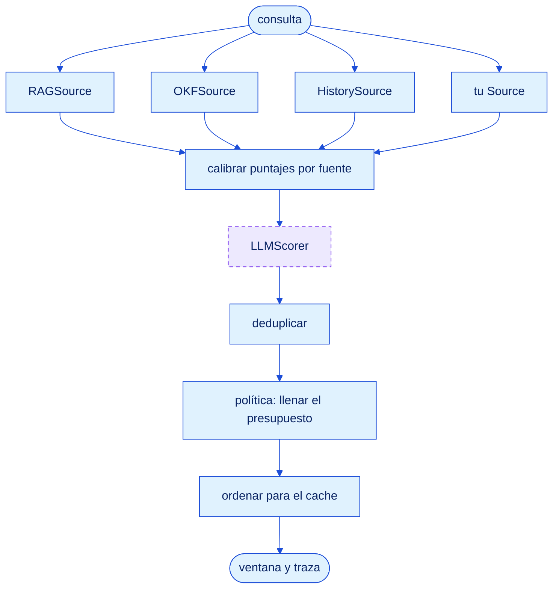

<p align="center">
  
</p>

# astromesh-context

**Decidí qué entra en la ventana de contexto de tu agente, y demostrá que fue la decisión correcta.**

[](https://monaccode.github.io/astromesh/#ecosystem)
[](https://www.python.org/)
[](https://github.com/monaccode/astromesh-context/blob/main/LICENSE)

*[Read in English](https://github.com/monaccode/astromesh-context/blob/main/README.md)*

La respuesta de un agente es tan buena como lo que el modelo lee antes de responder. La
recuperación trae candidatos, una base de conocimiento trae conceptos curados, la memoria
trae lo que el agente aprendió y la conversación no para de crecer. Alguien tiene que decidir
**qué de todo eso entra en la ventana, en qué orden y qué queda afuera**. Hoy esa decisión
está repartida entre plantillas de prompt, un `top_k` por acá y un recorte de historial por
allá, y nadie puede decirte si fue buena.

`astromesh-context` es esa decisión, tomada en un solo lugar:

- **Un presupuesto para todas las fuentes.** Los resultados de RAG, los conceptos OKF, los
  hechos de memoria y el historial compiten por los mismos tokens con un puntaje calibrado,
  en vez de recibir cada uno una porción fija.
- **Una traza por cada ítem.** Todo lo que propuso una fuente vuelve marcado como incluido o
  excluido, con el motivo: `budget`, `duplicate_of:…`, `below_floor`, `source_cap`,
  `deprecated`.
- **Un orden pensado para el prompt cache.** Lo estable va primero, idéntico byte a byte, para
  que las llamadas consecutivas compartan el prefijo más largo posible.
- **Una evaluación que lo demuestra.** `ContextEval` corre las mismas preguntas con distintas
  políticas y reporta recall, tokens gastados y reuso del prefijo, lado a lado.

El núcleo depende solo de PyYAML. [astromesh-rag](https://github.com/monaccode/astromesh-rag)
y [astromesh-okf](https://github.com/monaccode/astromesh-okf) se enchufan como fuentes con
extras opcionales.

## Instalación

La 0.1.0 todavía no está en PyPI; instalala desde el repositorio. astromesh-rag tampoco está en
PyPI, así que instalalo primero desde su release etiquetado y el extra `rag` lo usa:

```bash
pip install "astromesh-rag @ git+https://github.com/monaccode/astromesh-rag@v0.1.0"
pip install "astromesh-context[rag,okf] @ git+https://github.com/monaccode/astromesh-context@main"
```

Sumá los extras que uses: `rag` y `okf` para las fuentes, `tiktoken` para contar tokens con
exactitud, `llm` para `LLMScorer` por HTTP, `langchain`, `pydantic-ai` y `mcp` para las
integraciones, y `eval` para `ContextEval` con un embedder real. Python 3.10 o superior
(PydanticAI pide 3.11).

## El mapa: seis preguntas sobre el contexto

Contexto y conocimiento para agentes no es una técnica. Son seis preguntas, y cada una tiene
sus patrones. Así está parada cada librería de Astromesh.

| Pregunta | Patrones | En Astromesh |
|---|---|---|
| **¿Qué fragmento sirve?** (recuperación) | naive, hybrid, multi-query, HyDE, reranking, contextual retrieval, parent-document | [astromesh-rag](https://github.com/monaccode/astromesh-rag) |
| **¿Por dónde sigo?** (navegación) | índice en el system prompt, búsqueda agéntica con tools, llms.txt, progressive disclosure | [astromesh-okf](https://github.com/monaccode/astromesh-okf) |
| **¿Cómo se relaciona?** (grafos) | GraphRAG, grafos de entidades, grafos temporales | todavía no |
| **¿Qué aprendí?** (memoria) | conversacional, hechos semánticos, episódica, memoria autogestionada, consolidación | core de Astromesh; entra acá como fuente |
| **¿Qué entra en la ventana?** (ingeniería de contexto) | presupuesto de tokens entre fuentes, compactación, offloading de resultados de tools, orden estable para el cache, deduplicación, lost-in-the-middle | **astromesh-context** |
| **¿Le puedo creer?** (procedencia) | citas, frescura, verificación, fuentes en conflicto | señales de confianza y frescura de okf, respetadas acá |

Las dos primeras deciden *qué podría ser relevante*. Esta librería decide *qué lee
realmente el modelo*.

## Cómo se arma una ventana



Las fuentes corren en paralelo y solo **proponen**: ninguna conoce el presupuesto. Todo lo que
viene después es una función pura, así que los mismos candidatos con la misma política dan
siempre la misma ventana. El paso punteado es opcional y es el único que llama a un modelo.

1. **Calibrar.** Un coseno de 0.82, un BM25 de 14 y "el tercer turno más reciente" no son
   comparables. Los puntajes se normalizan por rango dentro de cada fuente y se ponderan por
   cuánto confiás en esa fuente. Las señales los ajustan a la vista: un concepto vencido
   puntúa menos (x0.7), uno revisado por una persona puntúa más (x1.1) y uno deprecado queda
   afuera.
2. **Puntuar con un modelo (opcional).** `LLMScorer` vuelve a puntuar los mejores candidatos
   en una sola llamada por lote y mezcla su puntaje con el calibrado. Si falla o se pasa del
   tiempo, la ventana se arma igual con los puntajes calibrados y la traza lo dice.
3. **Deduplicar.** Copias exactas por hash y casi-copias por contención de shingles de 5
   palabras: el solapamiento dividido por el tamaño del texto más chico, de 0.8 o más. Así un
   chunk de recuperación se reconoce como parte del concepto del que salió. La copia que se
   queda hereda las señales de la descartada, de modo que un chunk de RAG de una política que
   OKF marca como deprecada sale con ella. Esto es lo que atrapa a RAG y OKF trayendo la
   misma política dos veces.
4. **Llenar el presupuesto.** Lo fijado (el system prompt, el índice raíz de OKF) entra
   primero. Después un mínimo por fuente (el último turno del usuario, siempre) y el resto por
   puntaje, respetando un tope por fuente y un puntaje mínimo. Ponderar por valor por token
   existe como `beta` y por defecto vale 0 (mirá los [Resultados](#resultados)).
5. **Ordenar para el cache.** Primero lo estable en un orden fijo, después lo de la sesión y
   al final lo volátil, con lo más fuerte en los extremos de cada bloque, donde los modelos
   leen mejor. El historial queda cronológico y al final.

## Uso

```python
# needs: astromesh_rag, astromesh_okf
import asyncio

from astromesh_context import ContextEngine, HistorySource, ScoredKnapsack, StaticSource
from astromesh_context.sources import OKFIndexSource, OKFSource, RAGSource

# system_prompt: un str; pipeline: un Pipeline de astromesh-rag; messages: el chat hasta ahora
engine = ContextEngine(
    sources=[
        StaticSource(system_prompt, kind="instruction", pinned=True),
        OKFIndexSource("./kb"),            # el índice del bundle, fijado en el prefijo estable
        OKFSource("./kb", limit=10),       # conceptos completos, con confianza y frescura
        RAGSource(pipeline, k=20),         # chunks de un pipeline de astromesh-rag
        HistorySource(messages),           # la conversación; el último turno siempre entra
    ],
    policy=ScoredKnapsack(),
    budget=8_000,
)


async def main():
    window = await engine.build("¿Me devuelven la plata después de 3 semanas en el plan Team?")
    print(window.to_messages())            # formato OpenAI; style="anthropic" para Anthropic
    print(window.trace.explain())          # qué entró, qué quedó afuera y por qué


asyncio.run(main())
```

El mismo motor desde YAML. Una fuente de tipo `rag` nombra un objeto que le pasás vos, y una
fuente `history` lee los mensajes que le das a `build(..., vars=...)`:

```yaml
# file: support.context.yaml
apiVersion: astromesh/v1
kind: ContextPolicy
metadata:
  name: support
spec:
  budget: 8000
  policy: scored_knapsack
  sources:
    - { type: static, text: "Sos el agente de soporte de Nimbus.", pinned: true }
    - { type: okf_index, bundle: ./kb, pinned: true }
    - { type: okf, bundle: ./kb, limit: 10, weight: 1.2 }
    - { type: rag, pipeline: { object: support_rag }, k: 20, max_tokens: 3000 }
    - { type: history, key: history, min_items: 2 }
```

```python
# needs: astromesh_rag, astromesh_okf
import asyncio

from astromesh_context import load_engine

engine = load_engine("support.context.yaml", objects={"support_rag": pipeline})
window = asyncio.run(
    engine.build("¿Me devuelven la plata después de 3 semanas?", vars={"history": messages})
)
print(window.trace.explain())
```

Para mirar una ventana sin escribir código:
`astromesh-context explain --config support.context.yaml --query "..."`. Para agregar tu
propia fuente, política, scorer o tipo de mensaje, mirá [docs/extending.md](docs/extending.md)
(en inglés).

## Políticas

Una política decide cómo los candidatos llenan el presupuesto. Todas comparten la misma
firma, así la evaluación las compara de igual a igual.

| Política | Qué hace | Para qué |
|---|---|---|
| `ScoredKnapsack` | Un presupuesto, puntajes calibrados, topes, mínimos y pisos por fuente; `beta` suma ponderación por valor por token (por defecto 0) | La opción por defecto |
| `FixedSlots` | Una porción fija del presupuesto por fuente, llenada por prioridad | La línea base que usa todo el mundo hoy |
| `Everything` | Todos los candidatos, o un error claro si no entran (`truncate=True` llena por puntaje) | El control: cuánto cuesta "meter todo" |

```python
from astromesh_context import Everything, FixedSlots, LLMScorer, ScoredKnapsack, openai_compatible

knapsack = ScoredKnapsack(beta=0.0, min_score=0.1)
slots = FixedSlots({"okf": 0.3, "rag": 0.5, "history": 0.2})
control = Everything(truncate=True)

# LLMScorer es un paso de puntuación, no una política: pasalo como ContextEngine(..., scorer=scorer)
complete = openai_compatible("https://api.example.com/v1", "api-key", "model-name")
scorer = LLMScorer(complete, top_n=30, alpha=0.5, timeout=10.0)
```

`LLMScorer` funciona con cualquiera de ellas. Necesita el extra `llm` y cualquier endpoint
compatible con OpenAI.

## Dentro del loop del agente

Dos piezas opcionales para agentes de larga duración. Usan los mismos tipos y no necesitan el
motor: cada una trabaja sobre una lista común de mensajes de OpenAI o Anthropic, o sobre los
mensajes propios de tu framework a través de un `MessageAdapter`.

- **`Compactor`** resume los turnos viejos cuando el historial pasa un umbral y deja los
  últimos turnos textuales. Nunca separa una llamada a una tool de su resultado, porque los
  proveedores lo rechazan. Es incremental: el resumen anterior alimenta el siguiente.
- **`Offloader`** mueve a un store un resultado de tool que pasa el límite y deja en su lugar
  una vista previa y un handle. El agente lee lo que necesita con
  `ctx_read(handle, offset, limit)` y `ctx_grep(handle, pattern)`.

```python
import asyncio

from astromesh_context.loop import Compactor, Offloader


async def summarize(old_messages):
    # llamá a tu modelo acá; este reemplazo solo cuenta
    return f"{len(old_messages)} mensajes anteriores"


offloader = Offloader(max_tokens=1500, preview_tokens=200)
compactor = Compactor(summarize, threshold_tokens=6000, keep_last=6)

conversation = [
    {"role": "user", "content": "Buscá el pedido."},
    {
        "role": "assistant",
        "content": None,
        "tool_calls": [
            {"id": "c1", "type": "function", "function": {"name": "search", "arguments": "{}"}}
        ],
    },
    {"role": "tool", "tool_call_id": "c1", "content": "línea del pedido\n" * 2000},
]
conversation = offloader.offload(conversation)               # resultado grande: vista previa y handle
conversation = asyncio.run(compactor.compact(conversation))  # turnos viejos: un resumen
tools = offloader.tools()                                    # ctx_read y ctx_grep, para registrar
```

## Demostrarlo: `ContextEval`

Una estrategia de contexto es una afirmación sobre exactitud y costo, así que tiene que venir
con números. `ContextEval` pasa un set de preguntas etiquetadas por varias configuraciones. El
nivel 1 no llama a ningún modelo y reporta, para cada configuración y presupuesto, el recall de
la evidencia, la precisión por token, cuántas veces se cuelan distractores y políticas
reemplazadas, los tokens por llamada y cuánto del prefijo del prompt comparten las llamadas
consecutivas. El nivel 2 además responde cada pregunta con un modelo de chat y hace que un
juez califique la respuesta contra una referencia.

```bash
astromesh-context eval --level 1 --embedder st --out results/
```

## Resultados

Nivel 1, corrido el 2026-10-15 con embeddings `all-MiniLM-L6-v2` sobre el corpus Nimbus que
trae astromesh-rag (commit `a86bfba`): 60 casos con presupuestos de 750, 1000 y 2000 tokens.
El comando:

```bash
uv run --extra eval astromesh-context eval --level 1 --embedder st --out results/
```

| config | budget | recall | precision/token | distractor rate | superseded rate | noise share | tokens/call | candidate tokens | prefix reuse | stable tokens |
|---|---|---|---|---|---|---|---|---|---|---|
| everything | 750 | 0.550 | 0.072 | 0.350 | 0.000 | 0.040 | 748.700 | 3150.433 | 1.000 | 512.000 |
| everything | 1000 | 0.653 | 0.068 | 0.650 | 0.000 | 0.074 | 996.850 | 3150.433 | 1.000 | 512.000 |
| everything | 2000 | 0.750 | 0.041 | 1.000 | 0.033 | 0.140 | 1980.383 | 3150.433 | 1.000 | 512.000 |
| fixed_slots | 750 | 0.333 | 0.047 | 0.283 | 0.000 | 0.031 | 694.200 | 3150.433 | 1.000 | 512.000 |
| fixed_slots | 1000 | 0.606 | 0.071 | 0.467 | 0.000 | 0.045 | 893.833 | 3150.433 | 1.000 | 512.000 |
| fixed_slots | 2000 | 0.725 | 0.048 | 0.900 | 0.033 | 0.101 | 1642.433 | 3150.433 | 1.000 | 512.000 |
| scored_knapsack | 750 | 0.550 | 0.072 | 0.350 | 0.000 | 0.040 | 748.717 | 3150.433 | 1.000 | 512.000 |
| scored_knapsack | 1000 | 0.653 | 0.068 | 0.650 | 0.000 | 0.074 | 996.850 | 3150.433 | 1.000 | 512.000 |
| scored_knapsack | 2000 | 0.750 | 0.041 | 1.000 | 0.033 | 0.140 | 1980.383 | 3150.433 | 1.000 | 512.000 |
| scored_knapsack_density | 750 | 0.267 | 0.030 | 0.533 | 0.000 | 0.057 | 740.267 | 3150.433 | 1.000 | 512.000 |
| scored_knapsack_density | 1000 | 0.644 | 0.066 | 0.733 | 0.000 | 0.094 | 985.683 | 3150.433 | 1.000 | 512.000 |
| scored_knapsack_density | 2000 | 0.750 | 0.041 | 1.000 | 0.033 | 0.139 | 1971.417 | 3150.433 | 1.000 | 512.000 |

Los archivos están en [`results/`](results/). Acá `everything` se trunca al presupuesto, y
`candidate tokens` es lo que propusieron las fuentes antes de que corriera cualquier política,
así que todos los presupuestos son una exprimida. Cómo leer la tabla:

- Un presupuesto llenado por puntaje calibrado le gana a las porciones fijas por fuente cuando
  el presupuesto es ajustado. El recall es 0.550 contra 0.333 de `fixed_slots` con 750 tokens,
  0.653 contra 0.606 con 1000 y 0.750 contra 0.725 con 2000. El precio son más distractores
  (0.350 contra 0.283 con 750, 0.650 contra 0.467 con 1000), y con 1000 `fixed_slots` tiene
  una precisión por token apenas mejor (0.071 contra 0.068).
- La deduplicación entre fuentes por contención, más la marca de deprecado heredada por la
  copia que queda, mantiene afuera de la ventana las políticas reemplazadas: `superseded_rate`
  es 0.000 con 750 y 1000 y 0.033 con 2000 en todas las configuraciones. Antes de este cambio
  era 0.15 a 0.52, en la corrida del mantenedor en el commit `170d40a`.
- `prefix reuse` da 1.000 en todas las filas por construcción: en este eval sólo el system
  prompt y el índice OKF son estables, y los dos están fijados. Muestra que el orden mantiene el
  bloque estable idéntico byte a byte entre llamadas, no una tasa de aciertos de caché con un
  contenido que cambia de forma realista.
- `scored_knapsack` empata con `everything` truncado en recall, precisión y tasa de
  distractores en todas las filas (los tokens por llamada difieren en menos de 0.1 con 750),
  porque los dos llenan por orden de puntaje. Lo que el knapsack agrega sobre el truncado son topes, mínimos y pisos
  por fuente, no un mejor ranking.
- Ponderar por valor por token (`scored_knapsack_density`, `beta=0.5`) perdió con presupuestos
  ajustados en este corpus: recall 0.267 contra 0.550 con 750, 0.644 contra 0.653 con 1000, y
  empate con 2000. Por eso el valor por defecto es `beta=0`.

Los resultados de exactitud de respuesta (nivel 2) se van a agregar cuando se revisen las
respuestas de referencia. El comando es:

```bash
CTX_EVAL_BASE_URL=... CTX_EVAL_API_KEY=... CTX_EVAL_MODEL=... \
  uv run --extra eval astromesh-context eval --level 2 --embedder st --out results/
```

## Integraciones

Cada integración vive en su propio módulo y pide su extra. El motor y las piezas del loop
funcionan con el tipo de mensaje propio del framework. Los ejemplos reusan `engine`,
`compactor` y `offloader` de arriba.

**LangChain 1.x** (`astromesh-context[langchain]`): `ContextMiddleware` descarga y compacta el
hilo antes de cada llamada al modelo y, si le pasás un motor, agrega la ventana al mensaje de
sistema. `offload_tools` le da al agente `ctx_read` y `ctx_grep` como tools de LangChain.
Para un grafo que armás vos, `context_node(engine)` es un nodo de LangGraph para poner antes
del modelo: agrega la ventana como un `SystemMessage` llamado `context_window` y reemplaza el
del turno anterior.

```python
# needs: langchain
import asyncio

from langchain.agents import create_agent

from astromesh_context.integrations.langchain import ContextMiddleware, offload_tools

# model: cualquier modelo de chat de LangChain
agent = create_agent(
    model,
    tools=offload_tools(offloader),
    middleware=[ContextMiddleware(engine, compactor=compactor, offloader=offloader)],
)
question = {"messages": [{"role": "user", "content": "¿Dónde está mi pedido?"}]}
result = asyncio.run(agent.ainvoke(question))
```

**PydanticAI** (`astromesh-context[pydantic-ai]`, Python 3.11+): `history_processor` se
registra con la capability `ProcessHistory`.

```python
# needs: pydantic_ai
from pydantic_ai import Agent
from pydantic_ai.capabilities import ProcessHistory

from astromesh_context.integrations.pydantic_ai import history_processor, offload_tools

# model: cualquier modelo de PydanticAI
agent = Agent(
    model,
    tools=offload_tools(offloader),
    capabilities=[ProcessHistory(history_processor(compactor=compactor, offloader=offloader))],
)
result = agent.run_sync("¿Dónde está mi pedido?")
```

**MCP** (`astromesh-context[mcp]`, mcp 2.3 o superior): un servidor con `ctx_build`, que
devuelve la ventana y su traza, más `ctx_read` y `ctx_grep` si le pasás un offloader.

```python
# needs: mcp
from astromesh_context.integrations.mcp import serve

server = serve(engine, offloader)  # después server.run() para servir por stdio
```

Sin escribir código: `astromesh-context mcp --config support.context.yaml`.

Los demás frameworks que soporta astromesh-okf vienen después.

## Hoja de ruta

**v0.1:** `ContextEngine`; las tres políticas; calibración, deduplicación y orden para el
cache; `LLMScorer`; fuentes para RAG, OKF, historial, contenido estático y callables;
`Compactor` y `Offloader`; `ContextEval` con una primera comparación publicada de nivel 1; las
tres integraciones de arriba; YAML `kind: ContextPolicy`.

**Próximo:** los resultados de exactitud de respuesta del nivel 2; el primer release en PyPI.

**Después:** más integraciones con frameworks; una fuente de grafos; adopción por el core de
Astromesh, donde reemplaza el recorte de historial y el prefetch por plantillas de hoy.

## Licencia

Apache-2.0.
