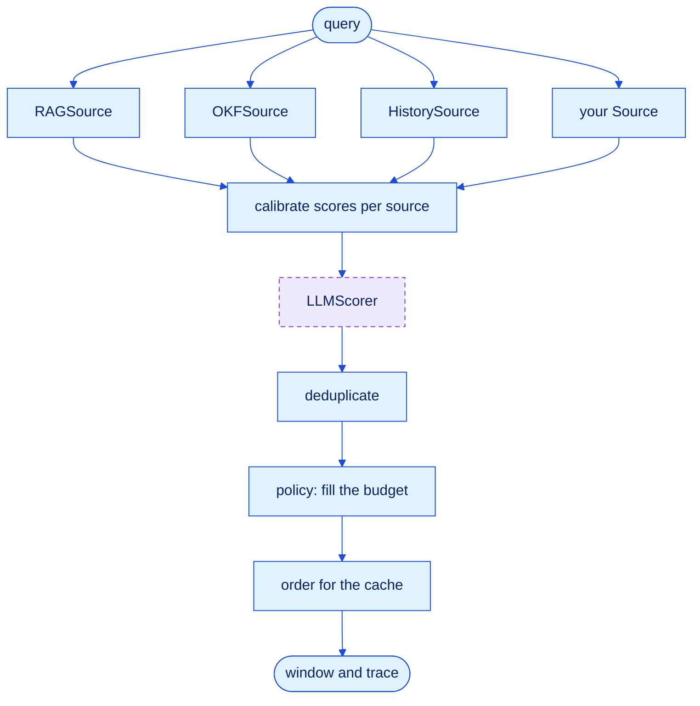

<p align="center">
  
</p>

# astromesh-context

**Decide what goes into your agent's context window, and prove it was the right call.**

[](https://monaccode.github.io/astromesh/#ecosystem)
[](https://www.python.org/)
[](https://github.com/monaccode/astromesh-context/blob/main/LICENSE)

*[Leer en español](https://github.com/monaccode/astromesh-context/blob/main/README.es.md)*

An agent's answer is only as good as what the model reads before it answers. Retrieval brings
candidates, a knowledge base brings curated concepts, memory brings what the agent learned,
and the conversation keeps growing. Something has to decide **which of all that fits in the
window, in what order, and what stays out**. Today that decision is scattered across prompt
templates, a `top_k` here and a history trim there, and nobody can tell you whether it was a
good one.

`astromesh-context` is that decision, made in one place:

- **One budget for every source.** RAG hits, OKF concepts, memory facts and chat history
  compete for the same tokens on a calibrated score, instead of each getting a fixed slice.
- **A trace for every item.** Everything a source proposed comes back marked included or
  excluded, with the reason: `budget`, `duplicate_of:…`, `below_floor`, `source_cap`,
  `deprecated`.
- **An order built for the prompt cache.** Stable content first, byte for byte, so
  consecutive calls share the longest possible prefix.
- **An eval that proves it.** `ContextEval` runs the same questions under different policies
  and reports recall, tokens spent and cache-prefix reuse side by side.

The core depends only on PyYAML. [astromesh-rag](https://github.com/monaccode/astromesh-rag)
and [astromesh-okf](https://github.com/monaccode/astromesh-okf) plug in as sources through
optional extras.

## Install

0.1.0 is not on PyPI yet; install from the repository. astromesh-rag is not on PyPI either, so
install it first from its tagged release and the `rag` extra resolves to it:

```bash
pip install "astromesh-rag @ git+https://github.com/monaccode/astromesh-rag@v0.1.0"
pip install "astromesh-context[rag,okf] @ git+https://github.com/monaccode/astromesh-context@main"
```

Add the extras you use: `rag` and `okf` for the sources, `tiktoken` for exact token counts,
`llm` for `LLMScorer` over HTTP, `langchain`, `pydantic-ai` and `mcp` for the integrations, and
`eval` for `ContextEval` with a real embedder. Python 3.10 or newer (PydanticAI needs 3.11).

## The map: six questions about context

Context and knowledge for agents is not one technique. It is six questions, and each has
its own patterns. This is where each Astromesh library stands.

| Question | Patterns | In Astromesh |
|---|---|---|
| **Which fragment helps?** (retrieval) | naive, hybrid, multi-query, HyDE, reranking, contextual retrieval, parent-document | [astromesh-rag](https://github.com/monaccode/astromesh-rag) |
| **Where do I go next?** (navigation) | index in the system prompt, agentic search with tools, llms.txt, progressive disclosure | [astromesh-okf](https://github.com/monaccode/astromesh-okf) |
| **How do things relate?** (graphs) | GraphRAG, entity knowledge graphs, temporal graphs | not yet |
| **What have I learned?** (memory) | conversational, semantic facts, episodic, self-managed memory, consolidation | Astromesh core; enters here as a source |
| **What fits in the window?** (context engineering) | token budgets across sources, compaction, tool-result offloading, cache-stable ordering, deduplication, lost-in-the-middle | **astromesh-context** |
| **Can I trust it?** (provenance) | citations, freshness, verification, conflicting sources | trust and freshness signals from okf, honored here |

The first two decide *what could be relevant*. This library decides *what the model actually
reads*.

## How a window is built



Sources run in parallel and only **propose**: none of them knows the budget. Everything after
them is a pure function, so the same candidates and the same policy always give the same
window. The dashed step is optional and is the only one that calls a model.

1. **Calibrate.** A cosine of 0.82, a BM25 score of 14 and "the third most recent turn" are
   not comparable. Scores are normalized by rank within each source, then weighted by how much
   you trust that source. Signals adjust them where you can see it: a stale concept scores
   lower (x0.7), a human-reviewed one higher (x1.1), a deprecated one is left out.
2. **Score with a model (optional).** `LLMScorer` rescores the top candidates in one batched
   call and blends its score with the calibrated one. If it fails or times out, the window is
   built anyway on the calibrated scores and the trace says so.
3. **Deduplicate.** Exact copies by hash, near-copies by containment of 5-word shingles: the
   overlap divided by the size of the smaller text, at 0.8 or more. A retrieval chunk is
   recognized as part of the concept it came from. The copy that stays inherits the dropped
   one's signals, so a RAG chunk of a policy that OKF marks deprecated goes out with it. This
   is what catches RAG and OKF returning the same policy twice.
4. **Fill the budget.** Pinned items (the system prompt, the OKF root index) go in first.
   Then a minimum per source (the last user turn, always), then the rest by score, respecting
   a cap per source and a score floor. Weighting by value per token is available as `beta` and
   defaults to 0 (see [Results](#results)).
5. **Order for the cache.** Stable items first in a fixed order, then session items, then
   volatile ones, with the strongest at the edges of their block, where models read best.
   History stays chronological and last.

## Usage

```python
# needs: astromesh_rag, astromesh_okf
import asyncio

from astromesh_context import ContextEngine, HistorySource, ScoredKnapsack, StaticSource
from astromesh_context.sources import OKFIndexSource, OKFSource, RAGSource

# system_prompt: a str; pipeline: an astromesh-rag Pipeline; messages: the chat so far
engine = ContextEngine(
    sources=[
        StaticSource(system_prompt, kind="instruction", pinned=True),
        OKFIndexSource("./kb"),            # the bundle index, pinned in the stable prefix
        OKFSource("./kb", limit=10),       # whole concepts, with trust and freshness
        RAGSource(pipeline, k=20),         # chunks from an astromesh-rag pipeline
        HistorySource(messages),           # the conversation, newest turn always kept
    ],
    policy=ScoredKnapsack(),
    budget=8_000,
)


async def main():
    window = await engine.build("Can I get a refund after 3 weeks on the Team plan?")
    print(window.to_messages())            # OpenAI shape; style="anthropic" for Anthropic
    print(window.trace.explain())          # what went in, what stayed out, and why


asyncio.run(main())
```

The same engine from YAML. A source of type `rag` names an object you pass in, and a `history`
source reads the messages you hand to `build(..., vars=...)`:

```yaml
# file: support.context.yaml
apiVersion: astromesh/v1
kind: ContextPolicy
metadata:
  name: support
spec:
  budget: 8000
  policy: scored_knapsack
  sources:
    - { type: static, text: "You are the Nimbus support agent.", pinned: true }
    - { type: okf_index, bundle: ./kb, pinned: true }
    - { type: okf, bundle: ./kb, limit: 10, weight: 1.2 }
    - { type: rag, pipeline: { object: support_rag }, k: 20, max_tokens: 3000 }
    - { type: history, key: history, min_items: 2 }
```

```python
# needs: astromesh_rag, astromesh_okf
import asyncio

from astromesh_context import load_engine

engine = load_engine("support.context.yaml", objects={"support_rag": pipeline})
window = asyncio.run(
    engine.build("Can I get a refund after 3 weeks?", vars={"history": messages})
)
print(window.trace.explain())
```

To look at one window without writing code:
`astromesh-context explain --config support.context.yaml --query "..."`. To add your own
source, policy, scorer or message type, see [docs/extending.md](docs/extending.md).

## Policies

A policy decides how candidates fill the budget. They share one signature, so the eval
compares them as equals.

| Policy | What it does | Use it for |
|---|---|---|
| `ScoredKnapsack` | One budget, calibrated scores, caps, minimums and floors per source; `beta` adds value-per-token weighting (default 0) | The default |
| `FixedSlots` | A fixed share of the budget per source, filled in priority order | The baseline everyone runs today |
| `Everything` | Every candidate, or a clear error if they do not fit (`truncate=True` fills by score instead) | The control: what "just stuff it all in" costs |

```python
from astromesh_context import Everything, FixedSlots, LLMScorer, ScoredKnapsack, openai_compatible

knapsack = ScoredKnapsack(beta=0.0, min_score=0.1)
slots = FixedSlots({"okf": 0.3, "rag": 0.5, "history": 0.2})
control = Everything(truncate=True)

# LLMScorer is a scoring step, not a policy: pass it as ContextEngine(..., scorer=scorer)
complete = openai_compatible("https://api.example.com/v1", "api-key", "model-name")
scorer = LLMScorer(complete, top_n=30, alpha=0.5, timeout=10.0)
```

`LLMScorer` works with any of them. It needs the `llm` extra and any OpenAI-compatible endpoint.

## Inside the agent loop

Two optional pieces for long-running agents. They use the same types and do not need the
engine: each works on a plain list of OpenAI or Anthropic messages, or on your framework's own
messages through a `MessageAdapter`.

- **`Compactor`** summarizes old turns once history crosses a threshold and keeps the last
  turns verbatim. It never splits a tool call from its result, which providers reject. It is
  incremental: the previous summary feeds the next one.
- **`Offloader`** moves a tool result over the limit into a store and leaves a preview and a
  handle in its place. The agent reads what it needs with `ctx_read(handle, offset, limit)` and
  `ctx_grep(handle, pattern)`.

```python
import asyncio

from astromesh_context.loop import Compactor, Offloader


async def summarize(old_messages):
    # call your model here; this stand-in only counts
    return f"{len(old_messages)} earlier messages"


offloader = Offloader(max_tokens=1500, preview_tokens=200)
compactor = Compactor(summarize, threshold_tokens=6000, keep_last=6)

conversation = [
    {"role": "user", "content": "Find the order."},
    {
        "role": "assistant",
        "content": None,
        "tool_calls": [
            {"id": "c1", "type": "function", "function": {"name": "search", "arguments": "{}"}}
        ],
    },
    {"role": "tool", "tool_call_id": "c1", "content": "order line\n" * 2000},
]
conversation = offloader.offload(conversation)               # big result: preview and a handle
conversation = asyncio.run(compactor.compact(conversation))  # old turns: one summary
tools = offloader.tools()                                    # ctx_read and ctx_grep, to register
```

## Proving it: `ContextEval`

A context strategy is a claim about accuracy and cost, so it should come with numbers.
`ContextEval` runs a labeled question set through several configurations. Level 1 makes no
model calls and reports, for each configuration and budget, recall of the evidence, precision
per token, how often distractors and superseded policies get in, tokens per call and how much
of the prompt prefix consecutive calls share. Level 2 also answers every question with a chat
model and has a judge grade the answer against a reference.

```bash
astromesh-context eval --level 1 --embedder st --out results/
```

## Results

Level 1, run on 2026-10-15 with `all-MiniLM-L6-v2` embeddings on the Nimbus corpus that ships
with astromesh-rag (commit `a86bfba`): 60 cases at budgets of 750, 1000 and 2000 tokens. The
command:

```bash
uv run --extra eval astromesh-context eval --level 1 --embedder st --out results/
```

| config | budget | recall | precision/token | distractor rate | superseded rate | noise share | tokens/call | candidate tokens | prefix reuse | stable tokens |
|---|---|---|---|---|---|---|---|---|---|---|
| everything | 750 | 0.550 | 0.072 | 0.350 | 0.000 | 0.040 | 748.700 | 3150.433 | 1.000 | 512.000 |
| everything | 1000 | 0.653 | 0.068 | 0.650 | 0.000 | 0.074 | 996.850 | 3150.433 | 1.000 | 512.000 |
| everything | 2000 | 0.750 | 0.041 | 1.000 | 0.033 | 0.140 | 1980.383 | 3150.433 | 1.000 | 512.000 |
| fixed_slots | 750 | 0.333 | 0.047 | 0.283 | 0.000 | 0.031 | 694.200 | 3150.433 | 1.000 | 512.000 |
| fixed_slots | 1000 | 0.606 | 0.071 | 0.467 | 0.000 | 0.045 | 893.833 | 3150.433 | 1.000 | 512.000 |
| fixed_slots | 2000 | 0.725 | 0.048 | 0.900 | 0.033 | 0.101 | 1642.433 | 3150.433 | 1.000 | 512.000 |
| scored_knapsack | 750 | 0.550 | 0.072 | 0.350 | 0.000 | 0.040 | 748.717 | 3150.433 | 1.000 | 512.000 |
| scored_knapsack | 1000 | 0.653 | 0.068 | 0.650 | 0.000 | 0.074 | 996.850 | 3150.433 | 1.000 | 512.000 |
| scored_knapsack | 2000 | 0.750 | 0.041 | 1.000 | 0.033 | 0.140 | 1980.383 | 3150.433 | 1.000 | 512.000 |
| scored_knapsack_density | 750 | 0.267 | 0.030 | 0.533 | 0.000 | 0.057 | 740.267 | 3150.433 | 1.000 | 512.000 |
| scored_knapsack_density | 1000 | 0.644 | 0.066 | 0.733 | 0.000 | 0.094 | 985.683 | 3150.433 | 1.000 | 512.000 |
| scored_knapsack_density | 2000 | 0.750 | 0.041 | 1.000 | 0.033 | 0.139 | 1971.417 | 3150.433 | 1.000 | 512.000 |

The files are in [`results/`](results/). `everything` here is truncated to the budget, and
`candidate tokens` is what the sources proposed before any policy ran, so every budget is a
squeeze. Reading the table:

- One budget filled by calibrated score beats fixed per-source slots at tight budgets. Recall
  is 0.550 against 0.333 for `fixed_slots` at 750 tokens, 0.653 against 0.606 at 1000 and 0.750
  against 0.725 at 2000. The price is more distractors (0.350 against 0.283 at 750, 0.650
  against 0.467 at 1000), and at 1000 `fixed_slots` has slightly better precision per token
  (0.071 against 0.068).
- Cross-source dedupe by containment, plus the deprecation flag inherited by the copy that
  stays, keeps superseded policies out of the window: `superseded_rate` is 0.000 at 750 and
  1000 and 0.033 at 2000 for every configuration. Before this change it was 0.15 to 0.52, in
  the maintainer's run at commit `170d40a`.
- `prefix reuse` is 1.000 on every row by construction: in this eval only the system prompt and
  the OKF index are stable, and both are pinned. It shows that the ordering keeps the stable
  block byte-identical across calls, not a cache-hit rate under realistic churn.
- `scored_knapsack` ties `everything` truncated on recall, precision and distractor rate on
  every row (tokens per call differ by under 0.1 at 750), because both fill by score order.
  What the knapsack adds over truncation is caps, minimums and floors per source, not a better
  ranking.
- Weighting by value per token (`scored_knapsack_density`, `beta=0.5`) lost at tight budgets
  on this corpus: recall 0.267 against 0.550 at 750, 0.644 against 0.653 at 1000, and a tie at
  2000. That is why the default is `beta=0`.

Answer-accuracy (level 2) results will be added after the reference answers are reviewed. The
command is:

```bash
CTX_EVAL_BASE_URL=... CTX_EVAL_API_KEY=... CTX_EVAL_MODEL=... \
  uv run --extra eval astromesh-context eval --level 2 --embedder st --out results/
```

## Integrations

Each integration lives in its own module and needs its extra. The engine and the loop pieces
carry over to the framework's own message type. The snippets reuse `engine`, `compactor` and
`offloader` from above.

**LangChain 1.x** (`astromesh-context[langchain]`): `ContextMiddleware` offloads and compacts
the thread before each model call and, if you give it an engine, appends the window to the
system message. `offload_tools` gives the agent `ctx_read` and `ctx_grep` as LangChain tools.
For a graph you build yourself, `context_node(engine)` is a LangGraph node to put before the
model: it adds the window as a `SystemMessage` named `context_window`, replacing last turn's.

```python
# needs: langchain
import asyncio

from langchain.agents import create_agent

from astromesh_context.integrations.langchain import ContextMiddleware, offload_tools

# model: any LangChain chat model
agent = create_agent(
    model,
    tools=offload_tools(offloader),
    middleware=[ContextMiddleware(engine, compactor=compactor, offloader=offloader)],
)
question = {"messages": [{"role": "user", "content": "Where is my order?"}]}
result = asyncio.run(agent.ainvoke(question))
```

**PydanticAI** (`astromesh-context[pydantic-ai]`, Python 3.11+): `history_processor` is
registered through the `ProcessHistory` capability.

```python
# needs: pydantic_ai
from pydantic_ai import Agent
from pydantic_ai.capabilities import ProcessHistory

from astromesh_context.integrations.pydantic_ai import history_processor, offload_tools

# model: any PydanticAI model
agent = Agent(
    model,
    tools=offload_tools(offloader),
    capabilities=[ProcessHistory(history_processor(compactor=compactor, offloader=offloader))],
)
result = agent.run_sync("Where is my order?")
```

**MCP** (`astromesh-context[mcp]`, mcp 2.3 or newer): a server with `ctx_build`, which returns
the window and its trace, plus `ctx_read` and `ctx_grep` when you pass an offloader.

```python
# needs: mcp
from astromesh_context.integrations.mcp import serve

server = serve(engine, offloader)  # then server.run() to serve over stdio
```

Without writing code: `astromesh-context mcp --config support.context.yaml`.

The other frameworks astromesh-okf supports follow.

## Roadmap

**v0.1:** `ContextEngine`; the three policies; calibration, deduplication and cache ordering;
`LLMScorer`; sources for RAG, OKF, history, static and callable content; `Compactor` and
`Offloader`; `ContextEval` with a first published level-1 comparison; the three integrations
above; `kind: ContextPolicy` YAML.

**Next:** level-2 answer-accuracy results; the first PyPI release.

**Later:** more framework integrations; a graph source; adoption by the Astromesh core, where
it replaces today's history trimming and template-based prefetch.

## License

Apache-2.0.
